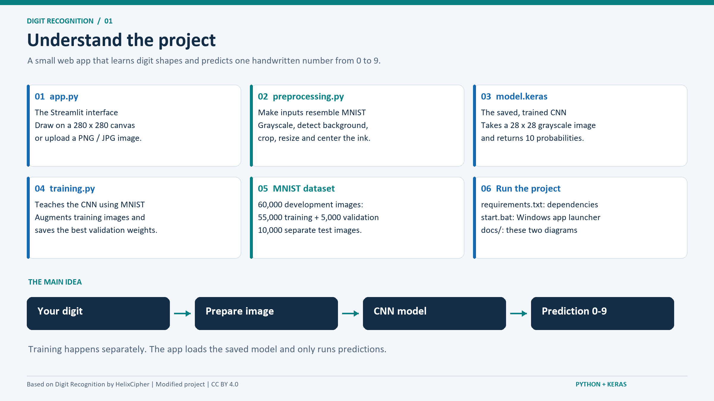
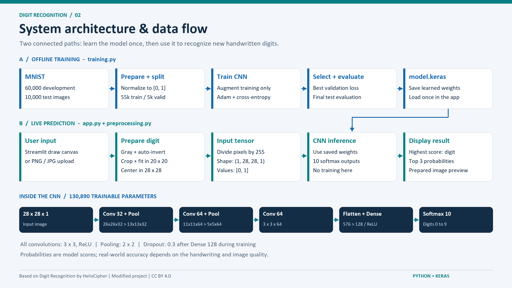

# Digit Recognition

<p align="center">
  
</p>

A Streamlit web application for recognizing handwritten digits (0-9) using a Convolutional Neural Network (CNN) trained on the MNIST dataset.

## Features

- **Draw Mode**: Draw a digit directly on the canvas.

- **Upload Mode**: Upload an image of a handwritten digit.

- **Real-time Prediction**: See prediction results instantly.

- **GPU Support**: Automatically detects and uses GPU if available.

## Installation

1. Clone the repository.

2. Create a virtual environment (optional but recommended):
   ```bash
   python -m venv venv
   source venv/bin/activate  # On Windows: venv\Scripts\activate
   ```
3. Install dependencies:
   ```bash
   pip install -r requirements.txt
   ```

## GPU Support (Optional)

For GPU acceleration, install the following:

- **CUDA Toolkit 12.x** - [NVIDIA CUDA Downloads](https://developer.nvidia.com/cuda-downloads)

- **cuDNN 8.x** - [NVIDIA cuDNN Downloads](https://developer.nvidia.com/cudnn)

After installation, restart the app. The app will display "GPU: X detected" in the header if successful.

### Verifying GPU Installation

To verify CUDA is installed, run:

```bash
nvidia-smi
```

This should display GPU information if CUDA is properly configured.

### Troubleshooting

If GPU is not detected after installing CUDA and cuDNN:

1. Ensure CUDA binaries are in your system PATH.

2. Verify cuDNN files are in the CUDA installation directory.

3. Restart your terminal or computer.

4. Reinstall TensorFlow: `pip install --upgrade tensorflow`.

If GPU is unavailable, the app will automatically run on CPU.

## Running the App

```bash
streamlit run app.py
```

The app will open in your default web browser at `http://localhost:8501`.

## Usage

### Draw Tab
1. Use your mouse to draw a digit (0-9) on the canvas.

2. The model will automatically recognize the digit and display prediction probabilities.

### Upload Image Tab
1. Upload an image file (PNG, JPG, or JPEG).

2. The model will process the image and display prediction results.

## Simple accuracy improvements in this version

The CNN architecture stays the same. Both drawing and upload modes now use
`preprocessing.py` to detect the background color, crop empty margins, preserve
the digit's shape, fit it into a 20x20 box, and center its ink in a 28x28 image.
This makes inputs closer to MNIST. Blank images are skipped, and transparent
PNGs are placed on white before processing. Use one clear digit per image.

`training.py` now uses 55,000 training images and 5,000 validation images. It
reduces the learning rate when validation loss stops improving and restores
the weights with the best validation loss. The 10,000 test images are used
only for final evaluation.

The existing `model.keras` has not been retrained in this update. MNIST was not
cached locally and the environment blocked its download, so a before/after
accuracy improvement has **not been measured**. The input changes take effect
immediately with the existing model. To train with the updated settings:

```bash
python training.py
```

This downloads MNIST if needed, prints the final test accuracy, and replaces
`model.keras`. Restart the app after retraining so it loads the new model.

To check preprocessing and saved-model inference:

```bash
python scripts/check_preprocessing.py
```

These checks cover positioning, background polarity, transparency, blank inputs,
small digits, centering, and valid model output. They do not measure accuracy.

## Project diagrams

### Visual presentation editions

These ImageGen editions add technology logos, digit illustrations, feature-map
visuals, and a matching dark presentation theme:

1. [Visual project overview](docs/01_project_overview_visual.png)
2. [Visual architecture and data flow](docs/02_architecture_dataflow_visual.png)

The prediction bars and learning curves are illustrative, not measured results.
Generation prompts are saved in [visual_diagram_prompts.md](docs/visual_diagram_prompts.md).

### Original diagrams

Both images are 2400x1350 PNGs (16:9) and can be inserted directly into slides.

1. [Project overview](docs/01_project_overview.png): explains the files and their roles.
2. [Architecture and data flow](docs/02_architecture_dataflow.png): shows training,
   live prediction, and the CNN layers with their output sizes.




To regenerate the diagrams with Pillow: `python scripts/create_diagrams.py`.

## Model Details

- **Architecture**: CNN with 3 convolutional layers, max pooling, and 2 dense layers.

- **Training Data**: MNIST (55,000 training, 5,000 validation, 10,000 test images in the updated script).

- **Data Augmentation**: Rotation, width/height shift, zoom.

- **Accuracy**: The original README reported ~99%; this has not been independently verified in this update.

## Files

- `app.py` - Main Streamlit application.

- `preprocessing.py` - Shared image preparation for drawing and uploads.

- `training.py` - Model training script.

- `model.keras` - Pre-trained Keras model.

- `requirements.txt` - Python dependencies.

- `docs/` - Project overview and presentation architecture images.

- `scripts/` - Diagram generation and preprocessing checks.

---

## License & Attribution

This project is licensed under the **Creative Commons Attribution 4.0 International (CC BY 4.0)** license.

You are free to **use, share, copy, modify, and redistribute** this material for any purpose (including commercial use), **provided that proper attribution is given**.

### Attribution requirements

Any reuse, redistribution, or derivative work **must** include:

1. **The creator’s name**: `HelixCipher`
2. **A link to the original repository**:  
   https://github.com/HelixCipher/digit-recognition
3. **An indication of whether changes were made**
4. **A reference to the license (CC BY 4.0)**

#### Example Attribution

> This work is based on *Digit Recognition* by `HelixCipher`.  
> Original source: https://github.com/HelixCipher/digit-recognition
> Licensed under the Creative Commons Attribution 4.0 International (CC BY 4.0).

You may place this attribution in a README, documentation, credits section, or other visible location appropriate to the medium.

Full license text: https://creativecommons.org/licenses/by/4.0/


---

## Disclaimer

This project is provided **“as—is”**. The author accepts no responsibility for how this material is used. There is **no warranty** or guarantee that the scripts are safe, secure, or appropriate for any particular purpose. Use at your own risk.

see [DISCLAIMER.md](./DISCLAIMER.md) for full terms. Use at your own risk.
